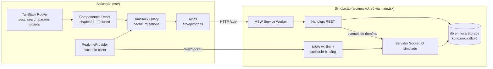
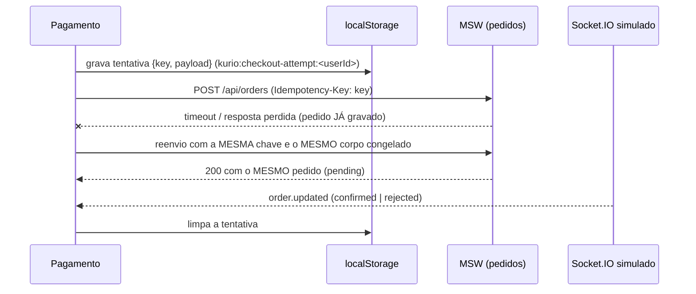
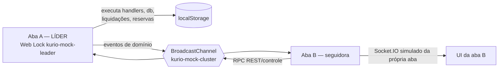

# KURIO — Arquitetura

Este documento descreve a solução **como ela está no código** (CP9). Contratos detalhados: [planning/API_CONTRACTS.md](planning/API_CONTRACTS.md). Rastreabilidade: [planning/REQUIREMENTS_MATRIX.md](planning/REQUIREMENTS_MATRIX.md).

> **Aviso.** Autenticação, pagamentos, carteiras e blockchain são **simulados** no navegador pelo MSW. Hash de senha, tokens, sessões e isolamento existem para que os fluxos se comportem como os reais e para que a interface não "finja" sucesso. **Isso não é a arquitetura de segurança de um backend de produção:** qualquer pessoa com o DevTools pode ler e alterar o banco simulado do próprio navegador.

## 1. Visão geral

Princípio central: **a UI nunca simula sucesso.** Toda confirmação vem de uma resposta HTTP ou de um evento Socket.IO produzido pela camada de mocks. Componentes, hooks e o cliente Axios não contêm respostas fictícias; uma regra de lint proíbe importar `src/mocks` fora de `main.tsx`.

## 2. Estrutura de diretórios

| Pasta | Responsabilidade |
|---|---|
| `src/main.tsx` | inicialização: importa o App em paralelo, inicia o MSW (se `VITE_ENABLE_MOCKS=true`) e só então renderiza |
| `src/app/App.tsx` | `QueryClient` (política de cache), `Router`, providers |
| `src/routes/` | rotas file-based do TanStack Router (`routeTree.gen.ts` é gerado) |
| `src/api/` | `contracts.ts` (schemas zod = tipos do transporte), `http.ts` (Axios + erros tipados), `queryKeys.ts` |
| `src/features/<área>/` | telas e hooks por domínio: `catalog`, `nft-detail`, `cart`, `checkout`, `orders`, `auth`, `account`, `favorites`, `home` |
| `src/realtime/` | ciclo de vida do socket, `eventGuard` (duplicatas e versões), `applyEvent` (efeitos no cache) |
| `src/components/ui/` | componentes shadcn/ui adaptados à identidade KURIO |
| `src/components/kurio/`, `layout/` | componentes do design system (cards, preço, estados vazios/erro, header, footer, navegação) |
| `src/lib/` | `eth.ts` (dinheiro em `bigint`), utilitários |
| `src/mocks/` | servidor simulado: `db`, `handlers/`, `realtime/server.ts`, `services.ts` (regras de domínio), `scenarios.ts`, `failures.ts`, `cluster.ts` (abas) |
| `e2e/` | testes Playwright (E2E, unitários, visuais, acessibilidade, evidências) |
| `scripts/` | Lighthouse, verificação do build público, licenças, geração de evidências e artes |
| `planning/` | requisitos, riscos, relatórios por checkpoint e evidências |

## 3. Fluxo de dados: React → Query → Axios → MSW

1. A rota valida os parâmetros (`validateSearch` com zod) e o componente chama um hook (`useCatalog`, `useCart`, `useOrder`…).
2. O hook usa `useQuery`/`useMutation` com uma chave de `queryKeys.ts`. Dados públicos ficam em `['nfts', …params]`; dados privados sempre em `['me', userId, …]`.
3. A função de consulta chama o `http` (Axios). O interceptor injeta o token e registra a **época da sessão**; a resposta é validada pelo schema zod do contrato.
4. O MSW intercepta `/api/*` no Service Worker e executa o handler, que lê e grava o `db` e emite eventos de domínio pelo servidor Socket.IO simulado.
5. Erros viram `ApiError` com `code` estável (`VALIDATION_ERROR`, `UNAUTHORIZED`, `NOT_FOUND`, `CONFLICT`, `OUT_OF_STOCK`, `QUOTE_STALE`, `IDEMPOTENCY_KEY_REUSED`, `TRANSIENT`…), mapeados em mensagens de UI.

## 4. Rotas e proteção

- Rotas file-based com `autoCodeSplitting` (cada tela em um chunk).
- O catálogo (`/` e `/mercado`) guarda busca, filtros, ordenação e página na URL: refresh e voltar/avançar restauram o estado. Mudar um filtro volta para a página 1.
- Rotas privadas (`/pagamento`, `/perfil`, `/perfil/carteiras`, `/favoritos`, `/pedidos`, `/pedidos/$orderId`) usam `beforeLoad` com o guard de `features/auth/guards.ts`: sem sessão, redireciona para `/login?redirect=<destino>`. O login só aceita destinos internos (sem open redirect).
- Login e cadastro: modal sobre a Início no desktop, página cheia no mobile.
- `notFound` para rota inexistente, NFT inexistente e pedido inexistente.
- `/demo/*` (PoC e galeria internas) só existe com `VITE_DEMO_ROUTES=true` (build dos testes).

## 5. Contratos REST e Socket.IO

Os schemas zod de `src/api/contracts.ts` são a fonte única: geram os tipos usados pela UI **e** validam respostas e corpos nos handlers do mock. Recursos: sessão e conta, NFTs (lista paginada com busca, filtros e ordenação; detalhe), favoritos, carrinho, cupom e cotação, pedidos (criação idempotente, consulta, recuperação por chave), perfil, avatar, senha e carteiras. Tabela completa em [API_CONTRACTS.md](planning/API_CONTRACTS.md).

Valores em ETH trafegam como **strings decimais**; quantidades são inteiros.

### Eventos

| Evento | Destino | Conteúdo |
|---|---|---|
| `nft.updated` | público | preço e disponibilidade por edição |
| `order.updated` | só o dono do pedido | estado, `txHash`, `settledAt`, `failureReason` |
| `cart.updated` | só o dono do carrinho | nova versão do carrinho (outra aba alterou) |

Envelope comum: `{ eventId, type, resource: { type, id }, version, occurredAt, userId?, data }`.

### Transporte e limitações

O `socket.io-client` conversa com um servidor Socket.IO simulado por `ws.link` do MSW e `@mswjs/socket.io-binding`. Ajustes necessários (detalhes em `planning/CP1_REPORT.md` §5):
- só transporte WebSocket (o MSW não intercepta o long-polling);
- o handshake só confirma o CONNECT depois de validar o token;
- o heartbeat é enviado pelo servidor simulado;
- o socket.io-client é avaliado depois de o MSW instalar a interceptação.

Não há namespaces nem rooms reais; o roteamento por usuário é feito pelo servidor simulado. MSW e binding estão fixados em versões exatas.

## 6. Cache, invalidação e sincronização

| Política | Valor | Motivo |
|---|---|---|
| `staleTime` | 30 s | eventos e reconciliação mantêm os dados frescos sem refetch constante |
| Retry de consultas | até 2 vezes, só para falhas transitórias (rede, timeout, 5xx) | 4xx nunca é repetido |
| Retry de mutations | nenhum automático | repetir operação de escrita é decisão explícita (idempotência) |
| Chaves | todos os parâmetros da consulta; privados sob `['me', userId]` | respostas de outra combinação ou outro usuário nunca se misturam |

- **Invalidação após mutations:** cada mutation atualiza ou invalida as chaves afetadas (ex.: carrinho → cotação; pedido → carrinho e lista de pedidos).
- **Atualização otimista com rollback:** favoritos. O estado anterior é guardado em `onMutate` e restaurado em `onError` com toast do erro real.
- **Respostas obsoletas:** o TanStack Query cancela consultas substituídas (`AbortSignal` no Axios). As leituras de carrinho e pedido são **monotônicas**: uma resposta REST com `version` menor que a do cache é descartada.

## 7. Sessão e isolamento entre usuários

- O token opaco do mock fica em memória, espelhado em `sessionStorage` (sobrevive a refresh; cada aba tem a sua sessão). Em produção seria um cookie `httpOnly`.
- **Época da sessão** (`sessionStore.epoch`): aumenta a cada login, logout, expiração ou troca de usuário. Respostas e eventos iniciados numa época anterior são descartados.
- No logout ou troca de usuário: consultas privadas em voo canceladas e o cache privado removido (`SessionEffects.tsx`), socket destruído com seus listeners; respostas atrasadas de requisições da sessão anterior são descartadas pela época. Um socket novo é criado com o token novo.
- Expiração (401 `SESSION_EXPIRED`) durante a navegação ou o checkout leva ao login com `motivo=expirada` e a intenção é retomada (favoritar, voltar ao pagamento com o rascunho).
- O mock filtra tudo por dono (404 para recursos de outro usuário) e o servidor Socket.IO só entrega eventos privados à conexão do dono. O cliente ainda descarta evento com `userId` diferente.

## 8. Carrinho: persistência e merge

- O carrinho vive na API simulada, inclusive o de visitante. O cliente guarda só um identificador aleatório (`kurio:guest-cart`).
- Ao autenticar, `POST /api/cart/merge` soma as quantidades no carrinho do usuário, respeitando o estoque. O identificador de visitante é descartado: quem sair começa com um carrinho vazio.
- O resumo (subtotal, desconto, taxa de rede, total) é sempre a **cotação da API** (`POST /api/quotes`), nunca um cálculo da UI.
- Mudanças de preço ou estoque (`nft.updated`) são aplicadas na linha e anunciadas (`role=status`), e a cotação é refeita.

## 9. Precisão monetária

`src/lib/eth.ts` converte strings decimais em `bigint` de wei (10¹⁸). Soma e multiplicação por quantidade usam inteiros; o arredondamento só acontece na formatação para exibição. Nenhuma conta de dinheiro usa `number`. O mesmo módulo é usado pela cotação do mock (`src/mocks/pricing.ts`).

## 10. Pedido: idempotência, recuperação e recibo

- **Idempotência:** a chave identifica a tentativa. Mesma chave + mesmo conteúdo = o mesmo pedido; mesma chave + conteúdo diferente = `409 IDEMPOTENCY_KEY_REUSED`. Depois de um resultado desconhecido (timeout, rede), o corpo do reenvio fica congelado.
- **Recuperação após refresh ou nova aba:** a tentativa salva é consultada em `GET /api/orders/by-key/:key`; se o pedido existe, a UI vai para ele em vez de criar outro.
- **Revalidação:** o pedido referencia a cotação aceita. Se preço, estoque, cupom ou taxa mudarem, a API responde `409 QUOTE_STALE` e a UI mostra antes → depois, exigindo nova confirmação.
- **Ciclo de vida:** `pending → confirmed | rejected` (terminais). Reserva de estoque de 10 min no relógio da simulação; confirmação depois do prazo vira `rejected` (`reservation_expired`) e o estoque volta uma única vez. O carrinho só é reduzido na confirmação, apenas nos itens e quantidades comprados.
- **Recibo:** snapshot gravado na criação do pedido (itens, edições, preços, cupom, taxa, rede, carteira). A tela do pedido só lê o pedido; mudanças posteriores no catálogo, no perfil ou nas carteiras não o alteram. Hash e explorador de transação são simulados.
- "Compra confirmada" só aparece com `status === 'confirmed'` vindo da API (REST ou evento).

## 11. Tempo real: reconciliação

- `eventGuard` (função pura): descarta `eventId` já visto (duplicata) e `version <=` a conhecida (antigo). A versão conhecida é a maior entre a do último evento aplicado e a do cache (que pode ter vindo do REST).
- Estados terminais do pedido nunca regridem.
- Em reconexão, ao voltar à aba (`visibilitychange`) e ao restaurar a página (`pageshow`), os recursos ativos são reconciliados pelo REST.
- Corrida REST × evento: uma resposta REST que saiu antes do evento e chega depois tem versão menor e é descartada (leituras monotônicas, §6).
- Listeners são removidos quando o socket da sessão é destruído e quando a tela deixa de assinar um pedido.

## 12. Várias abas: eleição de líder

Cada aba roda o MSW no próprio contexto. Para que todas vejam o mesmo "servidor":

- A aba que obtém o Web Lock é a líder e única escritora (sem atualizações perdidas; idempotência vale entre abas).
- As seguidoras encaminham REST e comandos ao líder e recebem os eventos pelo barramento; cada aba os entrega às próprias conexões Socket.IO. A UI continua sendo alterada só pelo `socket.io-client`.
- **Failover:** se a líder fecha, a próxima da fila do lock assume, recarrega o estado e retoma liquidações. RPCs pendentes são rejeitadas na hora, e o reenvio idempotente recupera.
- Sem Web Locks: modo independente, com aviso.

### Limitações da simulação no navegador

- Não há backend compartilhado: o banco é por navegador.
- Abas de origens diferentes ou navegadores diferentes não se enxergam.
- O "servidor" depende de uma aba aberta.
- Latências e falhas são injetadas pelo cenário, não pela rede real.
- O primeiro carregamento precisa baixar e iniciar o MSW antes de qualquer dado (impacto em performance, §14).

## 13. Desvios do Figma e decisões de UX

| Tema | Decisão |
|---|---|
| Assets | O Figma estava só para visualização (sem exportação). As artes dos NFTs são substitutas derivadas das capturas (recorte + ampliação), listadas em `planning/ASSETS_MANIFEST.md` e `public/assets/nfts/manifest.json`. Logos de terceiros só onde o design pede, sem integração |
| Galeria do detalhe | 2 vistas reais (o Figma mostra 4); não foram inventadas vistas |
| Confirmação, Perfil e Carteiras no mobile | sem frame no Figma: derivados do design system |
| Carrinho mobile | lixeira no canto do card; o título "Resumo da carteira" foi mantido pela estrutura de títulos |
| Pagamento | "Nome de usuário" somente leitura (vem do perfil); a observação vem por último |
| Carteiras | principal como formulário (como no Figma); secundária como resumo com Editar / Tornar principal |
| Notificações | no topo, abaixo do header, para não cobrir a barra fixa de compra |
| Ações fora do escopo | login social, redes sociais, newsletter e páginas editoriais mostram "indisponível nesta demonstração" e nunca aparentam sucesso |
| Acessibilidade × layout | rótulos visíveis ou acessíveis mantidos onde o Figma não mostra texto; alvos de toque ≥ 24 px; contraste ajustado onde o par de cores do Figma não passava (`planning/DESIGN_SYSTEM.md`) |

## 14. Performance e acessibilidade

**Performance:**
- MSW e App baixados em paralelo; Socket.IO sob demanda; code splitting por rota; hashes do seed pré-calculados; fonte self-hosted com fallback métrico (CLS ≈ 0); imagens com dimensões explícitas e `fetchpriority` na principal.
- Desktop atinge as metas. **Mobile não atinge 90:** a arte do NFT só pode ser pedida depois de o MSW iniciar e a API simulada responder (4G lento + CPU 4×).
- Hipóteses medidas e rejeitadas: renderizar antes do MSW (piorou o TBT) e reduzir as imagens (LCP inalterado). Detalhes em `planning/CP8_REPORT.md` §5 e `planning/evidence/cp9-perf/LEIA-ME.md`.

**Acessibilidade:**
- skip link, foco visível e preso em diálogos e drawers (com retorno);
- labels e erros associados (`aria-describedby`, `role=alert`), feedback em `aria-live` (toasts, preço alterado, estado do pedido);
- `alt` vindo da API, um `h1` por tela, movimento reduzido respeitado.

Auditoria automatizada em `e2e/a11y.spec.ts`. Não há declaração de conformidade WCAG (sem teste com leitor de tela).

## 15. Testes

Playwright contra o **build de produção** (`vite build` + `vite preview`), com o MSW ativo:
- projetos `unit`, `desktop-chromium`, `mobile-chromium` e `responsive`;
- cada teste parte de um banco resetado;
- tempo controlado pelo relógio da simulação, retenções (`hold`/`release`) e liquidação manual;
- os testes de tempo real passam pelo `socket.io-client`, e os de REST pelos handlers MSW.

Regressão visual com baselines Windows versionadas. Baselines Linux são geradas no container oficial (ver README).
