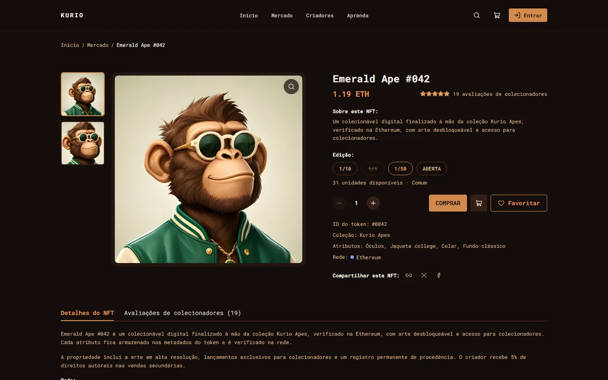
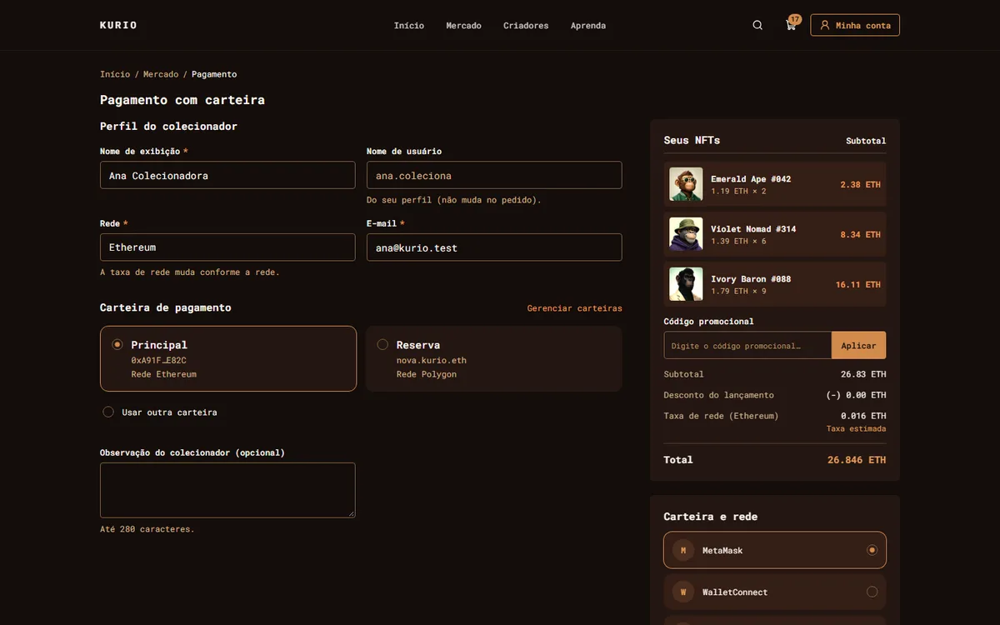
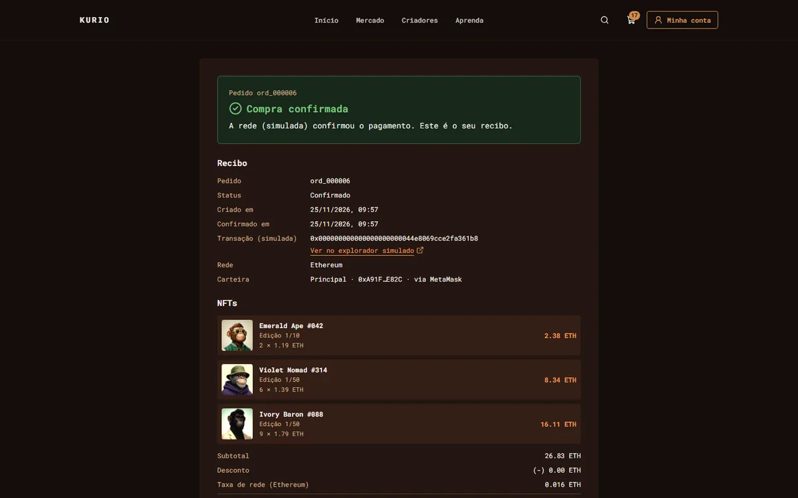
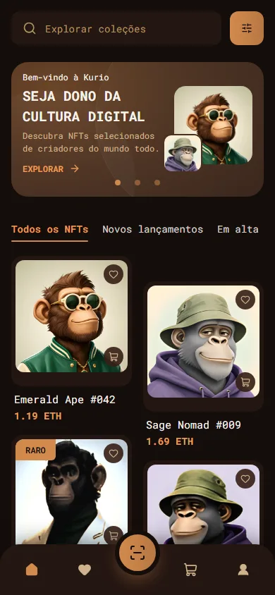
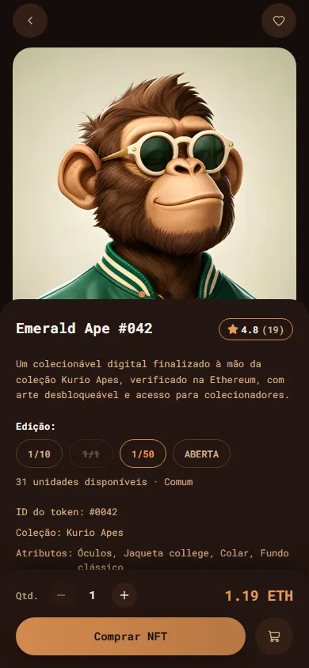
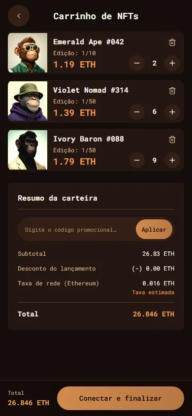
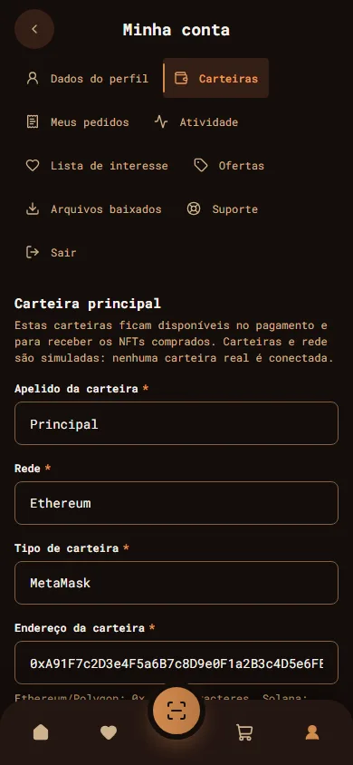

# KURIO — Marketplace de NFTs (desafio Frontend)

SPA em React + TypeScript que implementa o marketplace de NFTs do Figma do desafio: descoberta, detalhe, carrinho, pagamento com carteira, confirmação, login, cadastro, perfil e carteiras, em desktop e mobile.

**Tudo é simulado no navegador.** A API REST e o servidor Socket.IO são o MSW, rodando no próprio navegador (Service Worker + interceptação de WebSocket). Autenticação, carteiras, pagamentos e blockchain são fictícios: nenhuma credencial, carteira ou rede real é usada, e a "segurança" da simulação não representa um backend de produção.

- **Aplicação publicada:** https://kurio-nft-marketplace-flax.vercel.app (Vercel, deploy a cada push na `main`).
- **Repositório:** https://github.com/SouFadinho/kurio-nft-marketplace · CI: GitHub Actions (`.github/workflows/ci.yml`).
- **Documentação:** [ARCHITECTURE.md](ARCHITECTURE.md) (arquitetura, decisões, limitações e desvios do Figma) · [planning/API_CONTRACTS.md](planning/API_CONTRACTS.md) (contratos REST e eventos) · [planning/REQUIREMENTS_MATRIX.md](planning/REQUIREMENTS_MATRIX.md) (requisito → teste → evidência) · [planning/CP9_1_REPORT.md](planning/CP9_1_REPORT.md) (publicação, CI e resultados finais).

## Telas

Capturas reais da aplicação (build de produção com a API simulada). A pasta `planning/evidence/cp9/telas/` tem as 9 telas obrigatórias em 390, 768 e 1440 px.

| Início (desktop) | Detalhe (desktop) |
|---|---|
|  |  |
| **Pagamento (desktop)** | **Recibo confirmado (desktop)** |
|  |  |

| Início | Detalhe | Carrinho | Carteiras |
|---|---|---|---|
|  |  |  |  |

## Funcionalidades

| Área | O que funciona |
|---|---|
| Início e Mercado | destaques, catálogo com busca, filtros combináveis, ordenação e paginação na URL (refresh e histórico) |
| Detalhe do NFT | galeria, edições, limite de quantidade por estoque, favoritos (otimista com rollback), compra, NFT inexistente |
| Carrinho | adicionar, alterar e remover por edição; cupom (válido, inválido, expirado); resumo vindo da cotação da API; carrinho de visitante mesclado ao entrar; preço e estoque em tempo real |
| Pagamento | dados do colecionador, carteiras cadastradas ou outra, rede, conexão simulada (aceita, recusa, desconecta), revalidação da cotação antes de enviar, envio idempotente |
| Pedido e recibo | pendente → confirmado ou recusado (tempo real), recuperação após refresh, reconexão ou timeout; recibo com snapshot imutável; explorador de transação simulado |
| Conta | cadastro, login, logout, sessão após refresh, expiração com retomada, perfil, avatar, senha e carteiras principal/secundária |
| Tempo real | `nft.updated`, `order.updated` e `cart.updated` pelo `socket.io-client`, com deduplicação, versão e reconciliação REST |

## Stack

React 19.3.1 · TypeScript 5.9.3 (strict) · Vite 8 · TanStack Router 1.170.46 · TanStack Query 5.108.4 · Axios 1.21.1 · socket.io-client 4.8.4 · Tailwind CSS 4.3.5 · shadcn/ui (Radix) · MSW 2.15.0 + @mswjs/socket.io-binding 0.2.0 · zod 4 · Playwright 1.65.1 · Lighthouse 13.6.0. Versões exatas no `package-lock.json`.

## Pré-requisitos

- Node.js ≥ 22.19 (desenvolvido com 26.13.1, ver `.nvmrc`) e npm.
- Para os testes: Chromium do Playwright (`npx playwright install chromium`).

## Instalação e execução

```bash
npm ci                 # instala exatamente o lockfile
npm run dev            # desenvolvimento com mocks: http://localhost:5173
npm run build          # typecheck + build de produção (dist/)
npm run preview        # serve o build: http://localhost:4173
```

### Variáveis de ambiente

| Variável | Valor padrão | Efeito |
|---|---|---|
| `VITE_ENABLE_MOCKS` | `true` (em `.env`) | liga a camada MSW (REST + Socket.IO simulados). Obrigatória para a demonstração: não existe backend real |
| `VITE_DEMO_ROUTES` | não definida | `true` apenas no build dos testes: habilita as rotas internas `/demo/*` (PoC e galeria de componentes). No build público elas respondem 404 |

Não há segredos nem serviços externos.

## Credenciais fictícias

| Usuário | E-mail | Senha |
|---|---|---|
| Ana Colecionadora | `ana@kurio.test` | `Kurio#Ana2026` |
| Bruno Curador | `bruno@kurio.test` | `Kurio#Bruno2026` |

Cupons: `KURIO10` (10%), `COLECAO5` (5%), `NATAL2024` (expirado); qualquer outro código é inválido. As senhas ficam no banco simulado apenas como hash PBKDF2.

## Cenários da simulação e reset

O estado da simulação fica no `localStorage` do navegador e sobrevive a refresh.

- **Trocar de cenário (com reset):** `http://localhost:4173/?scenario=<nome>&reset=1`
- **Restaurar o cenário padrão:** `/?reset=1`
- Os parâmetros são removidos da URL antes de o app iniciar.

| Cenário | O que demonstra |
|---|---|
| `default` | latência de 120 ms, pedido confirmado após 1,5 s |
| `payment-rejected` | pagamento recusado pela rede simulada |
| `manual-settlement` | pedido fica pendente até ser liquidado pelo console |
| `slow` | latência de 1,5 s (skeletons) |
| `out-of-order` | buscas curtas respondem depois das longas (respostas fora de ordem) |
| `empty` | catálogo vazio |
| `catalog-error` · `catalog-offline` · `detail-error` | 503, falha de rede e 500 com recuperação por "Tentar novamente" |
| `broken-images` | imagens que falham (fallback no mesmo espaço) |
| `favorite-fail` | favoritar falha: rollback do otimista |
| `auth-offline` · `avatar-fail` · `profile-save-fail` | falhas de conta |
| `cart-error` · `cart-write-fail` | leitura/escrita do carrinho falham (itens preservados) |
| `wallet-refused` | a primeira conexão de carteira é recusada |
| `order-fail` | criação do pedido falha antes de gravar (503) |
| `order-timeout` · `order-lost-response` | o pedido é gravado e a resposta estoura o timeout ou se perde; o reenvio recupera o MESMO pedido |
| `slow-order` · `slow-settlement` | envio lento (cliques repetidos) e liquidação em 4 s |
| `hold-catalog` · `hold-quote` · `hold-order-read` · `slow-private` · `stale-in-flight` · `order-read-error` | retenções controladas usadas pelos testes de corrida |

Lista completa e parâmetros: `src/mocks/scenarios.ts`.

## Reproduzir eventos e falhas pelo console

No console do navegador, `window.__kurioMock` é o "lado servidor" da simulação: altera o banco simulado e emite eventos pelo servidor Socket.IO simulado. Nunca toca na UI ou no cache.

```js
// Preço e estoque em tempo real (nft.updated chega por Socket.IO ao catálogo, detalhe, carrinho e pagamento)
await __kurioMock.updateNft('nft-001', { price: '1.25' })
await __kurioMock.updateNft('nft-001', { editions: [{ id: 'ed-10', available: 0 }] })   // edição esgotada

// Pedido (use o cenário manual-settlement para controlar a liquidação)
await __kurioMock.orders()                                   // lista os pedidos
await __kurioMock.settleOrder('ord_000001', 'confirmed')     // ou 'rejected'

// Sessão e cotação
await __kurioMock.expireSessions()   // a próxima requisição privada recebe 401 (sessão expirada)
await __kurioMock.expireQuotes()     // o próximo pedido recebe 409 QUOTE_EXPIRED

// Rede do Socket.IO simulado (desconexão e reconexão com reconciliação REST)
__kurioMock.realtime.setOnline(false)
__kurioMock.realtime.setOnline(true)
__kurioMock.realtime.replayLast()    // reenvia o último evento (duplicata ignorada)

// Reset completo
await __kurioMock.reset('default')
```

Fluxos sugeridos:

1. **Preço muda durante o checkout:** coloque um NFT no carrinho, abra `/pagamento` e rode `updateNft` com outro preço. O resumo mostra antes → depois e a compra fica bloqueada até você aceitar os novos valores.
2. **Timeout com recuperação:** `/?scenario=order-timeout&reset=1`, compre e clique de novo após o erro. Volta o mesmo pedido (idempotência).
3. **Pedido pendente com queda de conexão:** `/?scenario=manual-settlement&reset=1`, compre e rode `setOnline(false)`, depois `settleOrder(...)` e `setOnline(true)`. A tela reconcilia e mostra o resultado; recarregar a página mantém o pedido.

## Testes e auditoria

```bash
npm run typecheck                # tipos
npm run lint                     # ESLint
npm run test:e2e                 # suíte Playwright completa (faz build + preview sozinho)
npm run test:e2e:browsers        # só os projetos de navegador (desktop, mobile, responsivo)
npm run test:unit                # testes de unidade (rodam no Playwright)
npm run test:visual              # regressão visual (baselines Windows versionadas)
npm run test:e2e:report          # abre o relatório HTML (traces das falhas)
npm run audit:lighthouse         # 12 auditorias (Início e Detalhe × mobile e desktop × 3)
npm run check:public-build       # build público: /demo/* em 404 e deep links
```

Smoke test da aplicação publicada (HTTPS, Service Worker, Socket.IO, autenticação, isolamento e compra), sem servidor local:

```powershell
$env:SMOKE_URL = "https://kurio-nft-marketplace-flax.vercel.app"; npx playwright test -c playwright.smoke.config.ts
```

Projetos Playwright: `unit`, `desktop-chromium` (1440 px), `mobile-chromium` (390 px), `responsive` (8 larguras). `retries: 0`; workers: `PW_WORKERS` ou 4 local / 2 na CI. Cada teste parte de um banco simulado resetado.

As baselines visuais versionadas existem para Windows (geradas localmente) e Linux (geradas na CI, no container oficial do Playwright, job manual `visual-baselines-linux`, e inspecionadas antes de versionar). Uma não é derivada da outra, porque a renderização de fonte difere.

## Resultados Lighthouse

Metas: Performance ≥ 90, Accessibility ≥ 95, Best Practices ≥ 95, SEO ≥ 90. Mesma auditoria (`npm run audit:lighthouse`: build de produção, MSW ativo, configuração padrão do Lighthouse, 3 execuções por página e perfil, mediana) em dois ambientes. Todos os relatórios HTML/JSON estão versionados em `planning/evidence/`.

**Execução independente na CI** (GitHub Actions, Ubuntu 24.04, 4 vCPUs, Node 26.13.1, Lighthouse 13.6.0, Chromium do Playwright 1.65.1; 3 rodadas em runners diferentes; a 3ª, no commit `27fa582`, deu 93 · 98 · 91 · 100 nas mesmas 4 combinações):

| Página | Perfil | Rodada 1 (Intel Xeon) | Rodada 2 (AMD EPYC) | LCP | CLS | TBT |
|---|---|---|---|---|---|---|
| Início | mobile | **92** (92 · 92 · 92) | **93** (93 · 93 · 93) | 3,14–3,18 s | 0 | 83–136 ms |
| Início | desktop | 98 | 99 | 0,97–1,18 s | 0 | 0 ms |
| Detalhe | mobile | **91** (91 · 91 · 91) | **92** (92 · 92 · 92) | 3,17 s | 0 | 121–182 ms |
| Detalhe | desktop | 100 | 100 | 0,66 s | 0 | 0 ms |

Accessibility 100, Best Practices 96 e SEO 92 em todos os perfis.

**Rodada oficial local** (notebook Windows 11, i5-1235U; commit do CP9.2): Início mobile **70** (59 · 92 · 70) e Detalhe mobile **65** (65 · 64 · 70); desktop 98 e 100. Repetição: 76 e 89.

Nesta máquina, as execuções ruins têm uma tarefa sem atribuição no início do carregamento (até ≈ 680 ms reais). Ela vem do Chrome headless emulando a GPU na CPU, não do código da página. Quando essa tarefa é pequena, o mesmo build marca 85–92. Nos runners da CI ela não aparece: em 35 das 36 execuções, cada combinação varia no máximo 1 ponto (exceção explicada no CP9_1_REPORT).

**Conclusão honesta:** a meta mobile é atingida no ambiente independente e não é atingida de forma estável na máquina local. Detalhes, causas e hipóteses medidas: [planning/CP9_2_REPORT.md](planning/CP9_2_REPORT.md) e [planning/CP9_1_REPORT.md](planning/CP9_1_REPORT.md).

## Limitações e diferenças do Figma

- **Simulação no navegador:** cada visitante tem o próprio banco (localStorage); abas da mesma origem compartilham um líder (Web Lock + BroadcastChannel). Não há backend compartilhado.
- **Sessão por aba** (sessionStorage), sem cookie httpOnly. Em produção seria diferente.
- **Assets:** o Figma estava disponível só para visualização. As artes dos NFTs são substitutas derivadas das capturas (`planning/ASSETS_MANIFEST.md`). A galeria tem 2 vistas reais (o Figma mostra 4).
- **Acessibilidade:** auditoria automatizada (axe em 12 telas, teclado, foco, reflow e alvos de toque). Sem teste com leitor de tela; não há declaração de conformidade WCAG.
- **Performance mobile:** ≥ 90 na CI; instável na máquina local (seção acima).
- **Cookies simulados:** o build troca a Public Suffix List do `tldts` (usada só pelo cookie jar emulado do MSW) por uma regra simplificada. O KURIO não usa cookies; diferenças e testes em `src/mocks/vendor/tldts-lite.ts`.
- **Domínio:** a URL pública é `kurio-nft-marketplace-flax.vercel.app`. O endereço sem o sufixo `-flax` pertence a outro projeto da Vercel.
- Desvios de layout e decisões de UX: [ARCHITECTURE.md §13](ARCHITECTURE.md#13-desvios-do-figma-e-decisões-de-ux).
